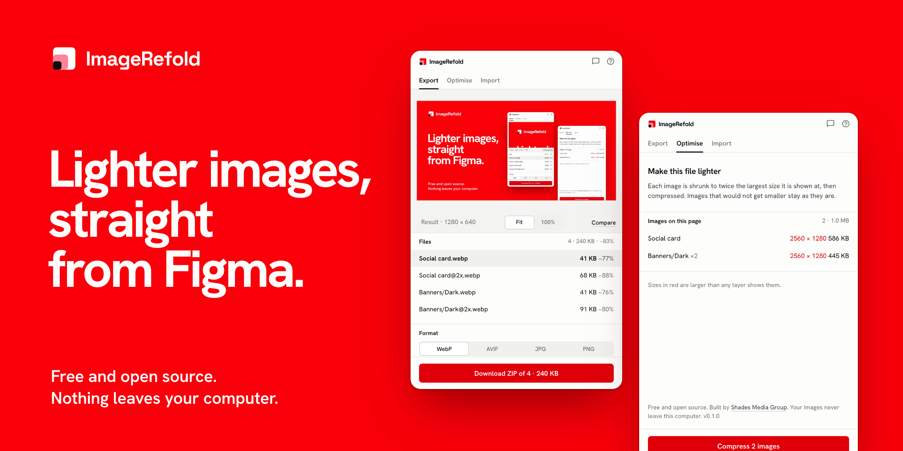

<a id="top"></a>

<p align="center">
  <picture>
    <source media="(prefers-color-scheme: dark)" srcset="assets/brand/readme-banner-dark.png">
    
  </picture>
</p>

<h3 align="center">Compress and export images from Figma, and bring them back in already light.<br>Free, open source, and nothing leaves your computer.</h3>

<p align="center">
  <a href="https://github.com/Shades-Media-Group/ImageRefold/actions/workflows/ci.yml"></a>
  <a href="LICENSE"></a>
  
</p>

<p align="center">
  <a href="https://imagerefold.shades.md"><b>Website</b></a> ·
  <a href="https://imagerefold.shades.md/#try"><b>Try it in the browser</b></a> ·
  <a href="CHANGELOG.md"><b>Changelog</b></a> ·
  <a href="https://imagerefold.shades.md/privacy/"><b>Privacy</b></a>
</p>

> **In development.** Version 0.1 of the Figma plugin works and can be run from source (below). Watch this repository to hear when the first release reaches the Figma Community.

## What it does

- **Every format worth shipping:** WebP, AVIF, JPG and PNG, lossy or lossless, with one quality control that means the same thing in each.
- **The size before you save:** each file's size and saving, with the original beside the result.
- **Every size at once:** 0.5×, 0.75×, 1×, 1.5×, 2×, 3×, 4× or an exact width, several in one export.
- **Whole selections:** every selected frame in one go, as separate files or one ZIP, named by a pattern you set.
- **A lighter file:** finds images larger than they are shown and swaps in lighter copies, in one undo step.
- **Compressed on the way in:** drop PNG, JPG, GIF, WebP or AVIF files into Figma already light, or use one as the fill of the selected layers.
- **Free with no catch:** no account, no plan, no limits, no server.

## Privacy

ImageRefold has no server. Every image is encoded inside the plugin, on your computer, and the plugin's manifest allows no network access, so Figma itself blocks any request. There are no accounts, analytics or crash reports. Read the [privacy policy](PRIVACY.md).

## Try it now

The [website](https://imagerefold.shades.md/#try) compresses an image of yours in the browser, with the original and the result side by side, so you can see the trade-off before the plugin ships. The page uses the browser's own encoder; the plugin uses dedicated encoders that make smaller files.

## Build from source

Requires Node 22 (see `.nvmrc`) and Yarn 1.

```bash
git clone https://github.com/Shades-Media-Group/ImageRefold.git
cd ImageRefold
yarn install
yarn build        # apps/figma-plugin/dist
yarn verify       # typecheck, lint, unit tests, plugin and website builds
```

In Figma desktop choose **Plugins → Development → Import plugin from manifest** and pick `apps/figma-plugin/manifest.json`.

| Command            | What it does                                               |
| ------------------ | ---------------------------------------------------------- |
| `yarn brand`       | Regenerates every logo file from one geometry              |
| `yarn assets`      | Renders the README banners, social card and touch icon     |
| `yarn deploy:site` | Builds, checks and deploys the website to Cloudflare       |
| `yarn release`     | Bumps the version, writes the changelog and tags a release |

## Part of the Shades family

ImageRefold is built on [Gradient](https://github.com/Shades-Media-Group/gradient), the Shades Media Group design system, and shares its panel design with [PageRecast](https://github.com/Shades-Media-Group/PageRecast).

## Contributing and support

- **An image came out wrong?** Open an [export report](https://github.com/Shades-Media-Group/ImageRefold/issues/new?template=export.yml) with the settings you used.
- **Questions and ideas:** [Discussions](https://github.com/Shades-Media-Group/ImageRefold/discussions) and [SUPPORT.md](SUPPORT.md).
- **Pull requests:** read [CONTRIBUTING.md](CONTRIBUTING.md) and the [Code of Conduct](CODE_OF_CONDUCT.md).
- **Security issues:** report them privately as described in [SECURITY.md](SECURITY.md).

## License

[MIT](LICENSE) © Shades Media Group. The name and logo are reserved: see [TRADEMARKS.md](TRADEMARKS.md).

---

<p align="center">
  Built by <a href="https://github.com/CristianBrinza">Cristian Brinza</a> | <a href="https://shades.md">Shades Media Group</a>
  <br>
  <sub><a href="#top">Back to top</a></sub>
</p>
